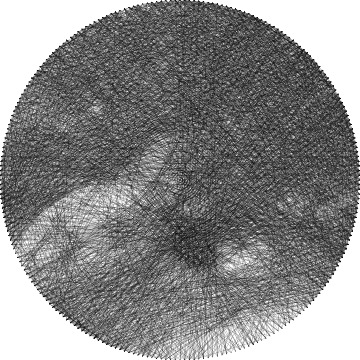
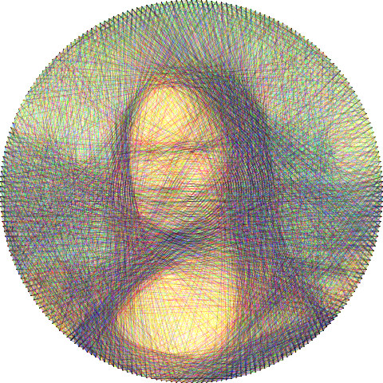
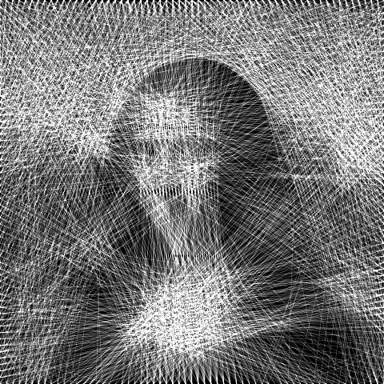

# threadreel

Turn any video into string art, in JavaScript.

threadreel hammers a ring of pegs around every frame of a clip, then runs a single thread from peg to
peg in straight lines, a few thousand times per frame, until the picture appears. Played back, the
thread moves. It runs in the browser with no build step, as a Node command line tool, and as a library.
The method follows Petros Vrellis's string-art pieces and Jérémie Piellard's
[image-stylization-threading](https://github.com/piellardj/image-stylization-threading), reimplemented
here for moving pictures.

**[Try it in your browser →](https://sankshitpandoh.github.io/threadreel/)**

| Big Buck Bunny, 10 fps | one frame | three colours | white on black, rectangle |
| --- | --- | --- | --- |
|  |  |  |  |

## How it works

1. A frame is shrunk to a small working copy (128 px by default). For a circular frame it is first
   cropped square. Every pixel records how much darker it still has to become: the *remaining*.
2. Pegs are placed around the frame (circle, ellipse or rectangle), and the straight line between every
   pair of pegs is rasterised once, as a list of pixel indices. All frames of a clip share these lines.
3. From the peg the thread is at, every other peg is a candidate. The average remaining along each
   candidate line is summed, and the thread goes to the best one. Pegs it visited in the last 20 moves,
   and pegs too close to the current one, are skipped.
4. Laying the thread subtracts its weight (opacity × thickness) along the line. A line whose average
   remaining is below half the weight would make the frame worse, so once no line is left above that
   mark, the frame is finished. Bright frames use fewer lines, dark ones more; the line count is a cap.
5. Colour mode keeps three remaining buffers, one per thread (cyan, magenta and yellow on white, or
   red, green and blue on black), and grows the thread that is furthest behind its share.
6. Frames are independent, so they are solved in parallel in Web Workers or `worker_threads`. The result
   of a frame is geometry (a list of peg numbers per thread), drawn again at any size on a canvas, with
   our own anti-aliased rasteriser, or as SVG. In the browser the video file is encoded with WebCodecs
   and muxed into MP4 or WebM; on the command line ffmpeg does the reading and writing.

Speed: a 128 px frame with 240 pegs takes about 0.1 ms per line, so a typical frame of 2,000 lines
solves in 0.2 s on one core. A 10 s clip at 12 fps is done in a few seconds on a laptop.

## Install

```bash
git clone https://github.com/sankshitpandoh/threadreel.git
cd threadreel
npm install
npm link   # optional: puts `threadreel` on your PATH
```

Requires Node 18 or newer. Video files need [ffmpeg](https://ffmpeg.org) on the PATH; pictures do not.

## Command line

```bash
threadreel -i clip.mp4 -o clip-threads.mp4          # a video, as string art
threadreel -i photo.jpg -o photo.png -o photo.svg    # one picture
threadreel -i photo.jpg -o photo.mp4 -intro 8        # a picture drawing itself in over 8 seconds
threadreel -i clip.mp4 -o frames/%04d.png -fps 24    # every output frame as a PNG
```

| Flag | Default | Description |
| --- | --- | --- |
| `-i` | n/a | input: PNG, JPEG, or any video ffmpeg can read |
| `-o` | n/a | output by extension: `.mp4` `.webm` `.gif` video; `.png` `.jpg` `.svg` one frame; `.txt` stringing instructions; `%04d.png` every frame. Repeatable |
| `-shape` | circle | `circle` (square crop), `ellipse`, `rectangle` |
| `-p` | 240 | pegs around the frame |
| `-n` | 2500 | most lines per frame (the search usually stops earlier by itself) |
| `-mode` | mono | `mono` or `color` |
| `-bg` | white | `white` with a dark thread, `black` with a light one |
| `-opacity` | 0.3 | how much one pass of thread covers, 0 to 1 |
| `-thickness` | 1 | thread width in thousandths of the frame's longer side |
| `-q` | 128 | working resolution for the search |
| `-s` | 1080 | output size, longer side |
| `-fps` | 12 | frames per second taken from the video |
| `-t` | all | use only the first N seconds |
| `-intro` | 0 / 6 | draw the first frame in over N seconds (6 for a still) |
| `-hold` | 0 / 2 | hold the last frame for N seconds (2 for a still) |
| `-pegs-visible` | off | draw the pegs |
| `-j` | all cores | worker threads |
| `-seed` | random | random seed for tie-breaks, for reproducible output |
| `-v` | off | report progress |

## Browser

Use the [live demo](https://sankshitpandoh.github.io/threadreel/), or serve the repository root over HTTP:

```bash
npm run demo   # then visit http://localhost:8080/
```

Drop in a video or a picture. Frames are read by seeking through a `<video>` element, solved in Web
Workers, and played back on a canvas. Saving a video uses WebCodecs where available (Chrome, Edge,
Safari 16.4+, Firefox 130+), writing MP4 (H.264) or WebM (VP9) through the vendored
[mp4-muxer](https://github.com/Vanilagy/mp4-muxer) and [webm-muxer](https://github.com/Vanilagy/webm-muxer);
elsewhere it falls back to MediaRecorder, which records in real time. Nothing leaves your machine.

## Library

```js
import { Threader, rasterize, toSVG, buildTimeline } from 'threadreel';
import { loadImage, savePNG, createNodePool } from 'threadreel/node';

const threader = new Threader({ shape: 'circle', pegs: 240, opacity: 0.3 });
const result = threader.solve(loadImage('photo.jpg'));
// result = { pegs: [{x, y}], threads: [{ color, pegs: [i, j, k, ...] }], segments, error, ... }

savePNG('photo.png', rasterize(result, { width: 1080 }));
const svg = toSVG(result, { width: 1080, showPegs: true });

// Step by step, for your own animation:
threader.load(image);
while (threader.step()) if (threader.segments % 100 === 0) draw(threader.result());
```

Images are plain `{ width, height, data }` objects with RGBA bytes, the same shape as a browser
`ImageData`. For many frames, `createNodePool(options)` (Node) or `createWebPool(options)` from
`threadreel/web` (browser) solve them in parallel through `solveFrames(pool, frames, onFrame)`.
`buildTimeline()` turns results into output frames, with an optional draw-in and hold.

### Options

| Option | Default | |
| --- | --- | --- |
| `shape` | `'circle'` | `'circle'`, `'ellipse'` or `'rectangle'` |
| `pegs` | 240 | pegs around the frame |
| `lines` | 2500 | maximum segments per frame |
| `mode` | `'mono'` | `'mono'` or `'color'` |
| `background` | `'white'` | `'white'` or `'black'` |
| `opacity` | 0.3 | thread opacity, 0..1 |
| `thickness` | 1 | thread width, 1/1000ths of the frame |
| `size` | 128 | working resolution |
| `recent` | 20 | a thread may not return to one of its last N pegs |
| `minGain` | 0 | stop earlier: require this much more than break-even from a line |
| `seed` | random | PRNG seed for tie-breaks |

## Design

The site follows [DESIGN.md](DESIGN.md): board white, pencil guide lines, black thread, one red
taken from a cotton reel, and Archivo throughout. Keep new pages and controls on those tokens.

## Tests

```bash
npm test
```

## License

MIT. The string-art method is Petros Vrellis's; the greedy search follows Jérémie Piellard's
image-stylization-threading (GPL-3.0), reimplemented from scratch here. The sample clip is from
*Big Buck Bunny*, © Blender Foundation, CC BY 3.0. See [LICENSE](LICENSE).
